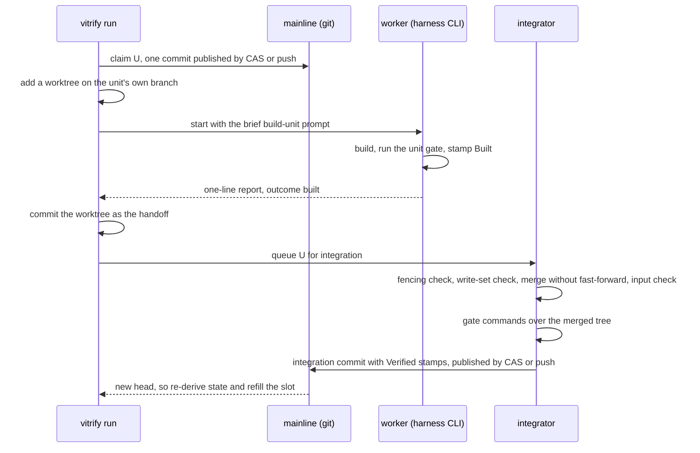

# Architecture

> Learn how vitrify's binary, core library, embedded content, git, and your harness CLIs fit together, where state lives, and how a build flows through them.

Use this page to understand how vitrify is built: its components, where state lives, and the order in which work flows through a run. The behavior it implements is explained without internals in the concept pages — [Work Units](concepts/units.md), [Gates](concepts/gates.md), [Build State](concepts/build-state.md), and [Runs](concepts/runs.md) — and the reasons behind each choice are in [Design Rationale](design-rationale.md). You do not need this page to use vitrify.

> [!NOTE]
> Bracketed keys such as `[update-ref]` cite [Sources](../reference/sources.md). Values marked **[j]** are judgment defaults: tunable knobs with no correctness weight. `RA-n` refers to a [rejected alternative](design-rationale.md#rejected-alternatives).

## Architecture Diagram

This diagram shows the binary and its two crates, the home directory `vitrify init` sets up, the external processes they drive, and the per-repository state.

```text
                     user's machine
 ┌──────────────────────────────────────────────────────────────────┐
 │ ~/.cargo/bin/vitrify            ~/.vitrify/                      │
 │ ┌─ vitrify (bin crate) ──────┐  config.toml   briefs/            │
 │ │ verbs      locate readset  │  (settings,    templates/         │
 │ │            claim trace     │◄─ profiles,    schemas/           │
 │ │            ledger journal  │   probe)       (disk wins)        │
 │ │            audit           │                                   │
 │ │ content    brief ×7 · help │──────────► git binary (subprocess)│
 │ │            new · schema    │                                   │
 │ │ machine    init · probe    │──────────► harness headless CLIs  │
 │ │            lint            │◄──────────  claude -p · codex exec│
 │ │ orchestr.  run             │──────────►  · opencode run        │
 │ └────────────────────────────┘            (inference workers +   │
 │ ┌─ vitrify-core (lib crate) ─┐             escalation calls)     │
 │ │ front-matter · mask/hash · │                                   │
 │ │ ledger · journal · audit · │                                   │
 │ │ claims · content registry  │                                   │
 │ └────────────────────────────┘                                   │
 └───────────────┬──────────────────────────────────────────────────┘
                 │ per-repository
 ┌───────────────▼──────────────────────────────────────────────────┐
 │ <repo>/specs/, docs/tdd/   SDD + TDD instances (schema 2.1)      │
 │ <repo>/.vitrify/           scratch: tx-* logs/ jobs/ run.json    │
 │                            (gitignored; nothing is built here)   │
 │ ~/.vitrify/worktrees/<repo>-<hash>/   outside the working tree:  │
 │                            mainline-<sdd>/ <sdd>-<unit>-c<n>/    │
 └──────────────────────────────────────────────────────────────────┘
```

## Runtime Model

These responsibilities define the runtime.

- **One binary plus git.** No interpreter runs anywhere at runtime; nothing else enters a repository, a harness sandbox, or a CI machine.
- **Deterministic control flow.** Control flow, scheduling, and state transitions are Rust; a model is invoked at exactly three points (see [Inference Placement](#inference-placement)).
- **git as the system of record.** Claims, stamps, and journal events land only through mainline commits; recovery is re-derivation from the repository.
- **Content on demand.** Procedures, schemas, templates, and each command's help are served by the CLI when invoked, never copied into harness discovery locations or into a repository.

## Main Runtime Pieces

vitrify is one binary built on a core library, plus a test-only stand-in worker and the external programs it probes. Each piece has one role.

- **`vitrify-core` (lib):** pure functions over repo paths — front-matter/yamlish parsing, masking + trace hashing, ledger derivation, journal append/replay/projection, the seven audit checks, claim-transaction planning, the embedded-content registry. No process management; never prints.
- **`vitrify` (bin, crate `vitrify-cli`):** the single multi-call binary — the per-tool-on-PATH distribution pattern other ecosystems standardized, transposed to cargo [cli-dist] [spec-kit-docs] [rust-cli-book] — clap surface, orchestrator, OS-process worker management (`std::process` + threads; no async runtime, RA-9), generators, subprocess git (RA-6). The exact crate name `vitrify` was registered by an unrelated project on 2026-10-08, so the crate is `vitrify-cli` with `[[bin]] name = "vitrify"` [crates-vitrify].
- **`stub-worker` (test bin, unpublished):** deterministic stand-in worker — builds units from the example's canned reference implementation, and answers an escalation as the judge with a canned verdict — so the orchestrator is testable without inference.
- **Embedded content:** the brief index and its 7 briefs, the escalation template, the two normative schema documents, instance templates — compile-time `include_str!`, materialized to `~/.vitrify/` by `vitrify init` [rust-embed] [cliff-embed] [mdbook-theme] — and the default `config.toml`, which `init` writes once.
- **External (probed, not built):** the `git` binary ≥ 2.30 **[j]** — the protocol's correctness primitive is its own CAS and worktree semantics [update-ref]; the three harness headless CLIs, each probed at its one streaming spelling — `claude -p --output-format stream-json --verbose`, `codex exec --json`, `opencode run --format json` — the interface each harness documents for scripts [cc-headless] [codex-exec] [oc-cli]; a harness that does not accept its spelling fails `vitrify init` and `vitrify probe`, which name the spelling it needs.

## Where Runtime State Lives

vitrify separates the authoritative state in your repository from scratch space, build checkouts, and machine-level settings. Use this table to see what each location holds.

| Location | Holds | Authority |
| --- | --- | --- |
| `<repo>/specs/`, and wherever the TDD lives | SDD and TDD instances: unit front matter, contracts, journal, ledger | The only authority, as committed on mainline |
| `<repo>/.vitrify/` | scratch: `tx-*` transaction checkouts (`tx-<pid>-<slug>-head` is a run's head checkout, `tx-<pid>-project-head` in a project run, which its lanes share), `logs/<job>/` (`project.json`, `events.jsonl`, the report, and per SDD under `<slug>/` the worker logs and `gate.json`), `jobs/` locks, `run.json`, `primary-behind` | None; carries a `*` ignore file, and nothing is built in it |
| `~/.vitrify/worktrees/<repo>-<hash>/` | per lane, `mainline-<slug>/` (its integration checkout, made anew at the start of each run) with its `mainline-<slug>.lock`, `base-<slug>/` (where a gate's failing rows run again on the gate's base) and `probe-<slug>/` (its culprit searches); and one `<slug>-<unit>-c<n>/` worktree per attempt | None; outside the working tree |
| `~/.vitrify/` (or `$VITRIFY_HOME`) | `config.toml` (settings, role profiles, the probe record), `briefs/`, `templates/`, `schemas/` — created by `vitrify init` alone | Machine-level settings and content |
| `<system temp>/vfy-<hash>/` | per-command `TMPDIR` slots, each held by a file lock while in use | None |

Protocol state lives entirely in the spec files, the journal, and the ledger, so everything else can be deleted without losing it; see [Uninstall](../getting-started/installation.md#uninstall).

## Claim Transactions

Each claim, renewal, and release is one atomic mainline commit. These rules make that safe under contention.

Each claim/renew/release is **one mainline commit** — front-matter edit + journal event + ledger regen — built in an ephemeral `.vitrify/tx-<pid>` worktree and published atomically, up to 3 attempts: re-check preconditions at the current head, apply edits (claim: status, holder, expiry = now + lease, `claim_seq += 1`), commit, publish — remote: `git push` (push rejection arbitrates cross-machine); local: `git update-ref refs/heads/<mainline> <new> <base>`, the CAS: "updates the … head to <new-oid> only if its current value is <old-oid>" [update-ref] [git-scm]. Never force. Lost race ⇒ resync and retry; exhausted ⇒ exit 5. Within one process — `vitrify run` claims, renews, releases and integrates from several threads — mainline transactions take turns, so the process never races itself; other processes are arbitrated by the CAS/push. The fencing token is the branch-name-carried `claim_seq` (`sdd/<sdd>/<unit>/c<seq>`), checked at the integration gate — the storage side "takes an active role in checking tokens, and rejecting any writes on which the token has gone backwards" [locking] [kleppmann-web]; expiry is advisory [leases].

## Managed Execution Pipeline

`vitrify run` is the managed pipeline: every unit flows through the same claim, build, gate, and publish steps. This sequence diagram follows one unit through it.



The rest of this section describes the pipeline stage by stage.

`vitrify run` is a deterministic state machine over repo state. Preflight, in three parts — the project (the SDDs and their unit graph, the harness, the worktree root, the remote), each lane's static checks, and each lane's dynamic checks, run in the lane's own checkout before anything is dispatched — refuses to start with the failing gate named, except that in a project run a lane whose own checks fail is blocked and the others go on; for one lane it is: SDD Active and committed at the mainline head; lint passes; audit clean (or only lapsed leases, fixed via the claim discipline); the SDD's §5 bootstrap, build and lint run clean (the Test command does not gate the start); ≥ 1 working harness probe; single-file shape forces worker cap 1. Then: print the job header (done-condition, plan, cap, holder scheme) **before** dispatch; release the claims of runs that died; and loop — derive state fresh (resume = re-derive, never remember), claim-then-build a worker for every claimable unit while a slot is free, renew leases when remaining < renew_fraction × lease, kill at `worker_timeout_minutes`, take each report as it arrives, integrate what is built, refill the slot. Termination is exactly **Complete** (every non-Retired unit Verified; audit exit 0; replay exit 0; the §5 Test command passing — all quoted) or **Blocked** (every remaining unit's blocker named); never success on a red audit. Crash recovery needs no engine: the "history" is the repo itself (journal + ledger + front matter), so recovery is re-derivation rather than replay — the property durable-execution engines obtain by recording activity results ("a Workflow Definition must be deterministic to support replay … put [LLM invocations] in Activities" [temporal-wf] [zenml] [temporal]), obtained here from git as the system of record [fowler]. `run.json` is observability only, never authoritative.

**Project runs: one process, a lane per SDD.** A plain `vitrify run` in a repository with several SDDs builds them all as one run (`--sdd <root>` builds one, `--upstream` adds the SDDs it depends on). The run is one process with one scheduler thread, which owns every decision, over a **lane** for each SDD. A lane is one SDD's part of the run, and each lane has its own integration checkout and lock (`<worktrees>/mainline-<slug>` and `mainline-<slug>.lock`), its own integrator thread, and its own lease keeper; the lanes read the mainline head from one head checkout (`.vitrify/tx-<pid>-project-head`), brought to each new head once. A run of one SDD is the same loop with one lane; a **project run** is the case of several lanes, and only it prints the project header, the `[<slug>]` lines and the per-SDD report. This diagram shows what the lanes share.

```text
vitrify run
 └─ one scheduler thread        every decision; one claim lock for every mainline write
      ├─ lane core   integrator thread · own checkout + lock · lease keeper
      ├─ lane api    …
      └─ lane docs   …
      shared: worker pool (run.worker_cap) · gate pool (run.gate_jobs) · signals · run record
```

Each SDD is resolved once, in preflight, and held from then on as a path under the repository root. Every checkout a lane reads — the primary, a unit worktree, its integration checkout, a transaction — resolves that path and nothing else, so a repository with fifteen SDDs is as unambiguous at the hundredth integration as at preflight. Names are namespaced the same way: `sdd/<slug>/<unit>/c<seq>` for branches, `<slug>-<unit>-c<seq>` for worktrees. A name that is already taken belongs to someone else — the claim sequence makes every name this run needs new — and is refused, never replaced. Because all the lanes live in one process, priority across SDDs is a sort inside one loop, and one lock serializes every mainline write and worktree operation, so lanes never contend for git's own locks.

**Two shared pools bound the whole run.** The **worker pool** bounds model sessions across every lane at `run.worker_cap` (default 20). The **gate pool** bounds commands at `run.gate_jobs` (one per core unless configured): every §5 command and every Verification row, from any gate, re-check, preflight, or culprit probe, takes one token while it runs, and waiters are served by priority, then by arrival. One token pool that every sub-build draws from is what POSIX make specifies for sub-makes [posix-make]; a limit per lane would let ten lanes run ten times the commands the machine was sized for. `run.lane_cap`, unlimited by default, bounds how many lanes hold checkouts on disk at once, admitting the lanes with the highest-priority work first; a lane with nothing left to do removes its checkouts.

**Pristine checkouts.** No gate result depends on what an earlier gate left behind. Each lane's checkouts are recreated at the start of each run, which also clears a stale lock file a crashed run left; before every gate, re-check, preflight, and culprit probe the checkout is reset to the commit being checked and cleaned with `git clean -ffdx`, so no untracked or ignored file survives. Only caches outside the checkout carry over. A stale lock left by a crash is the failure that "blocks all subsequent git operations across every agent" [worktrees].

**Dispatch follows one unit graph, continuously, longest chain first.** The resolver joins every SDD's units into one graph: nodes are `(slug, unit)`, and edges are `depends_on` entries, including those that name a pin, which lead to the units the pin's authority names as producers. The graph is ordered by Kahn's algorithm [kahn], and every cycle is refused before anything runs (see [Work Units](concepts/units.md#dependencies-and-parallel-groups)). A unit is dispatched when it is claimable and a worker slot is free; nothing waits for a "wave" or a whole SDD to finish. Any two claimable units are independent by construction — neither depends on the other, each has its dependencies built, and ownership is exclusive — so parallel groups are the author's plan, lint (L3) holds them to independence, and the scheduler needs only `depends_on`. When several units are claimable, the one with the longest chain of unfinished units behind it, in any SDD, goes first (Hu's labels [hu]); ties go by slug, then unit ID. That is list scheduling: a free slot never idles while a unit is claimable, which keeps the build within 2 − 1/m of the shortest possible on m workers [graham]. It does not promise that a larger cap is faster. A failure stays local: a unit that is blocked, set aside, or rotten never counts as built, so only the units that depend on it, in any SDD, wait, and everything else keeps building, gating, and landing. One thread decides; a monitor thread per worker renews its lease and enforces the hard budget; each lane's integrator thread owns that lane's integration checkout; a keeper per lane renews the leases of work waiting for the gate (RA-9: threads and `std::process`, no runtime).

**Where work happens.** Workers build and gates run in worktrees outside the repository's working tree, so that no ignore file of the repository is an ancestor of the files being checked. This is not tidiness: a checker that honours ignore files above its root (tach is one) reads nothing under a directory such a file covers, and passes. `.vitrify/` carries a `*` ignore file precisely so that the repository never sees vitrify's scratch — so nothing that is ever linted, built or tested may live under it. The same reasoning refuses a configured in-tree location that one of the repository's own ignore files covers.

Integration is serial within an SDD and concurrent across SDDs: each lane's integrator runs one gate at a time in the lane's own integration checkout, and a lock on that checkout makes two runs of one SDD take turns, while lanes of different SDDs gate side by side. The integrator takes every unit that is waiting in its lane as one batch: commit each handoff worktree under the fixed build message (workers never run `git commit` — protocol git operations belong to vitrify, and a worker is a harness session whose permission policy may forbid commits anyway); sync to head, first putting right what the audit can put right mechanically (lapsed leases released; units whose recorded trace no longer matches marked Stale), so that mainline's state is never held against the batch; **fencing check first** (branch token `c<seq>` equals current `claim_seq`; a superseded token is rejected outright even if the branch is green [locking]); the **write-set check** (every path the branch changed since it forked lies in the unit's write-set — the paths it `owns`, never the SDD's own files, plus the `status`, `built` and `trace` fields of its own entry — or the work is rejected before merging; tests get no exemption); merge `--no-ff`, one merge per unit (history keeps the unit boundary; with the write-set already checked, a conflict means mainline changed paths the unit may write — abort and escalate; "conflicts surface at the merge point" [worktrees]); the **input check** (the trace recorded when the unit was stamped Built equals the hashes of its inputs at this head — a unit built from text that changed while it was being built is not stamped Verified against text it never saw; it is rebuilt); then the full gate, once for the batch — the SDD's §5 bootstrap and build, the batch's Verification tables and those of the SDD's **dirty** Verified units — every unit whose own files, or whose dependencies' files, a commit since its last recorded check changed, which includes every dependent of the merged units, or, in an SDD with no Test command, every Verified unit (semantic conflicts between parallel units are caught exactly here; each distinct command runs once, `run.gate_jobs` of them side by side across the whole run — one per core unless configured — and a row that fails beside others is run again alone before it counts), the §5 Lint command, the §5 Test command as a regression check, then audit checks 1–3; on green, whatever the gate's commands wrote in the checkout is discarded and one integration commit is made: verified stamps + `built`/`verified` journal events + ledger regen + audit, then CAS/push publish of the merges and that commit, nothing else; on red, nothing is published — the integration checkout is reset to the synced head — and a batch of several is integrated again one unit at a time, so the units that are sound still land and the one that is not is named.

**Re-checks across SDDs.** An SDD's gate re-checks its own dirty units before the merge, so its mainline stays green. Code that another SDD's units depend on, through a pin listed in `depends_on`, changes after that merge, so the dependent lane re-checks its dirty units afterward, in dependency order, once no unit they depend on has work pending: their Verification rows, then the §5 Test command, with no worker and no model call. Passing units are recorded as verified again, in one commit with a `verified` event by actor `recheck`, which moves the point from which their next change is measured. A gate or a re-check blames a batch only for failures it caused: a failing row of an already Verified unit runs again on the base, and if it fails there too the unit is rotten — reported, never rebuilt, and holding back what depends on it — and a flake-aware culprit search traces the row to the commit that broke it, which can also conclude that a row is flaky rather than blame a commit. The probes run in a pristine checkout of their own and take gate-pool tokens, so they never hold up dispatch. A unit that is Built but never landed is adopted when its worker is known to be gone (the run set the attempt aside), its recorded trace still matches its reading set, and no gate or worker has judged it: a new claim sends it to the gate with no worker session. [Gates](concepts/gates.md) and [Build State](concepts/build-state.md) describe these records and checks.

The gate's verdict survives protocol traffic. While a gate runs, the same process claims and renews and releases, and each is a mainline commit. Those commits change journals, ledgers and the managed fields of unit entries — nothing a build, a test or a lint reads — so when the head has moved only by such commits the merges are replayed on it and published, and the gate does not run again. Any other change voids the verdict and the batch is gated again from the new head.

**The Test command** is the one gate step with history. Lint must pass from the start (preflight requires it); Test need not — whether tests exist or pass before the build is the SDD's posture (RA-16). So it gates as a regression check: if it passed at the head before the merge it must pass after it, and while it fails there it judges nothing. Its state before the merge is known from the previous integration, or measured when a failure makes the question matter. A build is Complete only when it passes. This is what closes the gap between "every Verification row is green" and "the suite is green": rows select tests one by one and cannot see a module that no longer collects, or a test another unit broke.

**Nothing an attempt produces is discarded.** An attempt that does not land is committed to its own branch under a note recording the outcome and the reason, and the unit's next worker starts from the files it owns there. Because the note and the branch are in git, and the journal says which attempts a later verification superseded, this needs no memory across runs. Interruption is the same path: a signal stops the workers and the gate, sets every attempt aside this way, releases the claims and closes the record; a run that could not do that for itself (killed outright, power lost) is recognized by the next run — its job lock is free — which does it instead.

**The primary checkout follows; it is never reset.** Every published commit moves a branch the user's own checkout may be on. vitrify brings that checkout along the way a fast-forward merge would — a two-way merge of index and files from the commit they hold to the new one (`read-tree -m -u`) — which carries uncommitted work with it and, when a local change or an untracked file is in the way of a published change, refuses with nothing touched. A checkout that could not follow is behind its own branch, where a commit made from it would undo what was published; so the run says so at once and again at its end, a marker (`.vitrify/primary-behind`) records which commit the files hold, and the next commit or the next run catches up from there (RA-23).

**A living spec, mid-run.** State is re-derived from the head, so a change entry that lands while a run is going is simply the new truth: units whose recorded trace no longer matches are marked Stale and rebuilt, a worker building from the old text is stopped, a unit parked on an open question rejoins when its reading set changes, and the input check guarantees nothing built from the old text is stamped against the new. Staleness is applied mechanically only once a run is under way; at preflight an unmarked mismatch is still a refusal, so that a spec edit nobody meant does not quietly become a rebuild.

## Inference Placement

The model is invoked at exactly three points, each with a fixed input and a fixed output that deterministic code acts on.

The orchestrator **drives inference; inference never drives the loop**:

1. **Workers** — one per claimable unit, as many at once as the cap allows; the full prompt is generated by `vitrify brief build-unit --unit U --holder H`: the four-part delegation discipline — objective (one unit), output format (the report line), tool/source guidance (the unit's resolved reading set), boundaries (write only `owns` paths; stop at `Q-###` rather than guess) — verbatim what the multi-agent canon demands: "an objective, an output format, guidance on the tools and sources to use, and clear task boundaries" [mar].
2. **Escalation** — on a merge conflict during integration (mainline changed paths the unit may write after its branch forked), or — once per unit — when its work has failed `abort_failed_waves` times (with its last gate failure as evidence): one call carrying the failure evidence; the reply is a single JSON verdict (`{"verdict":"retry|release|block|abort","unit":…,"q":…,"reason":…}`) parsed and **enforced by the orchestrator, not by the model**. One malformed reply gets one re-ask; a second ⇒ abort. Verdicts land in `run.json`/logs; only their *effects* append journal events — the journal's closed vocabulary has no verdict event. Strongest available model at maximum effort (the `escalation` role in `~/.vitrify/config.toml`) — the "smart friend" invoked as a tool at hard points [cognition].
3. **Authoring assist** — interactive sessions following `vitrify brief authoring`, outside `vitrify run`; splitting/sizing happens **here, at plan time**, frozen as a reviewed artifact and validated by `vitrify lint`.

Grounding: deterministic orchestration matches LLM-controlled accuracy while improving worst-case robustness and cutting run-to-run variance [det-orch]; Anthropic's taxonomy reserves LLM orchestration for tasks whose subtasks "aren't pre-defined" — an SDD pre-defines them by construction [bea]; own the control flow in code, with the model emitting structured outputs that deterministic code acts on [12fa] [12factor-web] [temporal-wf]; write-side multi-agent decision-making fragments without it [cognition]. Sizing is a constraint system, not a dispatch-time judgment: one unit = one worker session/context window, fan-out bounded by what the integrator can gate [nibzard] [ctx-eng] [harness-init] [orchestra]. **Adding an inference point requires a design revision, not code alone.**

## Content System

The procedures, documents, and help that agents read are part of the binary, so that one install carries one consistent version of them.

Briefs, templates, and schemas are embedded at compile time — a hand-written `include_str!` registry with literal SHA-256 digests and a completeness test; no embed crate, no `build.rs` — and materialized to `~/.vitrify/` by `vitrify init`, the only command that creates the home; **a file on disk overrides the embedded copy**. A manifest records the vitrify version and the shipped digests: an unmodified default refreshes automatically whenever the binary's embedded copy differs — an upgrade, or a rebuild of the same version; user overrides stay and `vitrify probe` flags them (including forks of a different shipped copy); deleting a file restores the default. The default `config.toml` — every setting, and the harness role profiles — is embedded the same way, but `init` writes it once and nothing refreshes it: it is the user's file. This is the mdBook-theme / git-cliff embedded-config pattern [mdbook-theme] [cliff-embed] [rust-embed]; the briefs are skills-style progressive disclosure with the CLI as the on-demand tier [skills-eng] [cc-features]. Home-dir resolution honors `$VITRIFY_HOME` before `$HOME/.vitrify` (hermetic tests never touch the real home), following the config precedent [codex-config].

The content is in three tiers, and anything new goes into one of them ([Design Rationale](design-rationale.md#agent-first-presentation)):

- **Procedures.** `vitrify brief` with no task prints the brief index — one line per procedure, what it is for, and who runs it — and `vitrify brief <task>` prints one brief. Use this table to see the seven.

  | Brief | For | Run by |
  | --- | --- | --- |
  | `onboard` | taking a repository from nothing to ready-to-build, or naming the gaps | an agent session |
  | `authoring` | a PRD to an Approved TDD and an Active, lint-clean SDD | an agent session |
  | `change` | changing TDDs and SDDs, one or many, and recording what each change stales | an agent session |
  | `run` | starting, watching, and reading a `vitrify run` build | an agent session |
  | `kickoff` | driving the build loop from a session instead of `vitrify run` | an agent session |
  | `build-unit` | building one unit; with `--unit` and `--holder` it prints a worker's whole prompt | workers |
  | `integrate` | taking one built unit through the gate to Verified | the integrator |

  Every brief opens with its purpose, a `Use when:` line, a `Not for:` line, and the vitrify version, and ends with the report it asks for. Values the configuration decides — the worktree location, the run's status check interval — are filled in at print time.
- **Formats.** `vitrify schema show` and `vitrify schema show --tdd` print the SDD and TDD schemas.
- **Help as content.** Each command's `--help` documents the command completely: what it reads, writes, and prints, its exit status, and examples, under fixed headings ([Develop vitrify](../contribute/development.md#help-text)). The root `vitrify --help` groups the commands by task and names the procedure that fits each. Help is compiled from `crates/vitrify-cli/src/cli.rs` and `crates/vitrify-cli/src/help/`; insta snapshots hold its text [insta], and a tier-1 conformance test holds every `vitrify …` line in `crates/vitrify-core/assets/` and `docs/` to the command tree the binary parses.

Nothing in the content system writes into a repository or a harness's folders: an agent reaches all of it through the installed binary. Why help is the front door, why each brief is one task, and where else agent material could have lived are in [Agent-First Presentation](design-rationale.md#agent-first-presentation).

## Security and Observability

vitrify's trust model is narrow: it runs git and your harness, executes the commands your spec names, and records what it does.

Vitrify stores no credentials and opens **no network connections** — inference rides the user's harness CLI auth; the only network activity is git's own fetch/push with the user's credentials (one shell-out rationale: "libgit2 is notably lacking in the realm of authentication" [git-fetch-cli]). The subprocess surface is closed: exactly `git` and the probed harness argv templates, argv-style, never a shell-interpolated string — with one fixed exception: audit check 4 and the gate execute the SDD's own §5 Commands and Verification rows via the shell, by design (the spec is trusted input; it is the thing being built). Workers and those commands run in process groups of their own, stopped with `kill(2)`. Each such command, and each worker, gets a `TMPDIR` that is its alone while it runs: test runners that share one temp root trip over each other when they run side by side (pytest is one: concurrent sessions share `$TMPDIR/pytest-of-<user>` and race on its `pytest-current` link). The directories are a few stable slots under the system temp root (`vfy-<hash>/`, mode 0700, each held by a file lock while in use) that are reused, not removed: a build daemon a command leaves behind keeps a temp directory that still exists. Repo state is the only authority: claims, stamps, and journal events land only through mainline commits published by CAS/push. Workers run in per-unit worktrees; the write-set check rejects out-of-ownership changes — tests and spec text included — mechanically rather than by trust. A worker's stdout and stderr go straight to its log files as the harness writes them, and its prompt is kept beside them. stdout is data, stderr diagnostics, `--json` on every read verb [skill-scripts]; the journal is the audit trail [fowler]; termination reports quote their evidence; no telemetry leaves the machine. What a run exposes while it works, and where, is listed under [Monitor a Run](../user-guides/monitor-a-run.md).

## Process Management

Every process vitrify starts can be stopped, and every run can be told apart from a dead one.

Worker/probe kill mechanics: every spawned worker gets its own Unix process group (`CommandExt::process_group`, stable since Rust 1.64 [proc-group]); timeout kill is SIGKILL to the group — shipping harnesses wrap shell calls precisely "to kill the process group on" timeout [harness-eng]. A group of its own also means the terminal's Ctrl-C never reaches a worker, so `vitrify run` handles SIGINT, SIGTERM and SIGHUP itself (a flag set in the handler, polled by the loop; under `run`, gate commands get their own groups too) and stops what it started. Run liveness is a held file lock, not a pid: the operating system frees it however the process ends, and a pid can be reused. Scale ceiling: nothing in vitrify assumes more than hundreds of units; larger scales enter only via a measured design revision.

## Related Topics

- [Runs](concepts/runs.md) — the same pipeline from the user's side: project runs, lanes, preflight, dispatch, retries, interrupts, and termination.
- [Gates](concepts/gates.md) — what the integration gate checks, step by step.
- [Design Rationale](design-rationale.md) — why the pipeline is deterministic and where each threshold comes from.
- [Data Model and Formats Specification](../reference/formats.md) — the formats the pipeline reads and writes, and how they are versioned.
- [Develop vitrify](../contribute/development.md) — how the pipeline is tested without inference.
