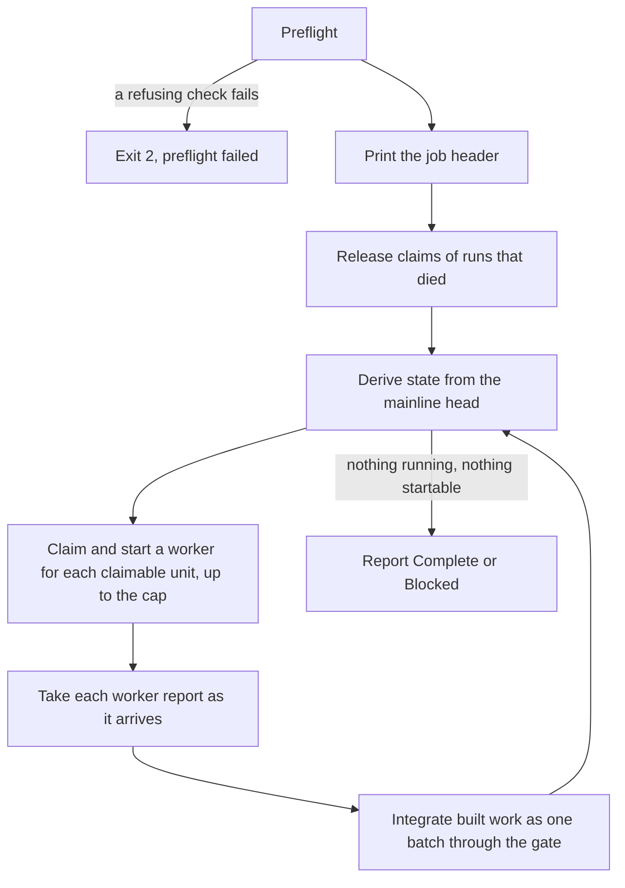

# Runs

> Understand what `vitrify run` does between preflight and its Complete or Blocked report: project runs over several SDDs, dispatch, integration, retries, spec changes, interrupts, and where the work happens.

Use this page to learn how the orchestrator behaves, so that what you see during a build makes sense. A **run** is one invocation of `vitrify run`: a deterministic state machine over repository state that drives inference workers through your harness CLI until every SDD it builds is Complete or Blocked. For the steps to start and resume a build, see [Run a Build](../../user-guides/run-a-build.md); for the internals, see [Architecture](../architecture.md#managed-execution-pipeline).

## Why the Orchestrator Exists

A procedure a model follows varies from run to run. vitrify keeps control flow, scheduling, and state transitions in Rust and invokes a model only at the leaves: each worker builds one unit, and an escalation call judges a unit that keeps failing. The orchestrator drives inference; inference never drives the loop. The same state machine is also written down as an interactive procedure, `vitrify brief kickoff`, for building from a harness session.

## What a Run Is

A run builds every Active SDD in the repository, or the one you name, and is identified by its job ID.

- **A project run.** A plain `vitrify run` in a repository with several SDDs builds every Active one as one deterministic, concurrent, incremental build over one graph of units; an SDD that is still Draft is left out. `--sdd <root>` builds one SDD only, and `vitrify run --sdd <root> --upstream` builds it together with the Active SDDs it depends on, which is a project run when that makes more than one; a unit that waits on an SDD outside the selection ends the run as a blocker that names it. A repository with one SDD, or a run that names one with `--sdd`, is the same run with one lane, and it is not a project run: it prints the single-SDD header and report, and any failure in its preflight refuses the run (see [The Job Header](#the-job-header) and [Termination](#termination)).
- **One lane per SDD.** A **lane** is one SDD's part of the run: its own integration checkout and lock, its own integrator, and its own records; the lanes share one head checkout, from which each new mainline head is read once. The SDDs are resolved once, in preflight, and each is pinned by its path under the repository root: every later step — claims, worker prompts, the gate, the reports — reads that same path in whichever checkout it is working in, and never searches again.
- **One job ID.** `run-<UTC timestamp>-p<pid>` names everything the run writes: its holders are `<job>-w<i>`, and its logs are in `.vitrify/logs/<job>/`, with each lane's records under `.vitrify/logs/<job>/<slug>/` and the plan and lane states in `.vitrify/logs/<job>/project.json`.
- **Namespaced work.** Branches are `sdd/<slug>/<unit>/c<seq>` and worktrees `<slug>-<unit>-c<seq>`, carrying the SDD's slug, so nothing of one SDD is touched by another. A name that already exists belongs to someone else: the run refuses it rather than replace it.

SDDs order each other through units. A unit whose `depends_on` names a pin waits until the units that produce the pinned contract, in the other SDD, are built; a pin it only consumes orders nothing (see [Work Units](units.md#dependencies-and-parallel-groups) and [Contracts](contracts.md#pins-carry-order-too)). A project run refuses, exit 4 and naming the SDDs, while a `schema_version: 2.0` SDD has units that consume pins: the version is what says whether a pin it lacks in `depends_on` is an interface read or a need not yet declared. `--sdd` builds such an SDD alone.

## Run Lifecycle

A run keeps every worker slot busy until nothing more can happen. This diagram shows the loop.



1. **Preflight** refuses to start if a check that refuses the run fails; in a project run, a check of one lane blocks that lane instead.
2. **The job header** prints the plan and parameters, and the `Watch:` line, before anything is dispatched.
3. **Recovery** releases the claims of runs that died.
4. **Dispatch** starts a worker for the claimable units, longest chain of remaining work first, while a slot is free.
5. **Reports** arrive one line per worker, as each session ends.
6. **Integration** gates what is built, in each lane, as one batch and publishes it.
7. **Re-derivation** reads state from the head again and refills the freed slots.
8. **Termination** prints exactly one report when nothing is running and nothing can start, and keeps it.

## Run Behavior

Each stage follows these rules.

### Preflight

`vitrify run` refuses to start if a project check fails, prints each failure as one `preflight failed: <cause> → <fix>` line, and exits 2. In a project run it also blocks a lane whose own checks fail, printing its failures as `[<slug>] preflight failed: <cause> → <fix>`; a run of one SDD has no other lane to go on with, so any failure refuses it. Preflight has three parts:

- **Project**, before anything runs: every SDD is readable (a schema version this vitrify does not read is a failure), at least one is Active, no SDD at schema 2.0 has units that consume pins (exit 4; every other failure exits 2), the unit graph resolves and has no cycle, slugs are unique, a harness is recorded and its role profiles parse, the worktree root is usable, and a local mainline is not ahead of `origin`. A failure refuses the whole run.
- **Lane, static**, at the start for every lane: the SDD is Active, nothing is uncommitted under its root, lint is clean, the audit is clean (it runs no Verification row; the re-check cascade decides which rows run again), and the journal replays. In a project run a failure blocks that lane, and the units that depend on its units wait.
- **Lane, dynamic**, before the lane's first build or re-check — in a run of one SDD, at the start; in a project run, when the lane is first admitted, on its integrator's thread: the lane's integration checkout is made anew at the mainline head, and the §5 Bootstrap, Build, and Lint commands run clean in it. A failure blocks the lane the same way. In a run of one SDD, the re-check of the Verified units a change has reached since their last recorded check follows, and a unit whose row fails is rotten from the start; in a project run the lane's re-checks happen in the loop, in dependency order, once nothing a unit depends on has work pending.

Use this table to see what each check requires and the fix its line names.

| Check | Passes when | Fix |
| --- | --- | --- |
| SDD | the SDDs resolve: a plain run builds every Active SDD in the repository, and `--sdd` names one; `--upstream` without `--sdd` is refused | none in the repository: `vitrify brief authoring`; an `--sdd` outside the repository: pass one inside it |
| Status | the SDD is `status: Active` | finish authoring and set it Active: `vitrify brief authoring` |
| Clean tree | no uncommitted changes under the SDD's root | commit or stash the changes under `<root>` |
| Unique slug | no other SDD in the repository shares its `sdd:` slug | rename one of the `sdd:` slugs |
| Unit graph | every `depends_on` entry resolves, every pin in `depends_on` names an authority with producer units, and no cycle runs through the units of any SDD; every cycle is printed as the path that closes it, and the units that merely wait behind a cycle are named apart from it | one line per cycle, each with its closing path (`core U-004 → api U-002 → core U-006 → core U-004`); remove one `depends_on` edge on each |
| Mainline | the primary checkout is not behind mainline, and with `origin`, every commit of the local branch is on `origin` | bring the checkout up to date as the note before the line says; publish local commits first (`git push origin <branch>`) |
| Lint | `vitrify lint --built` is clean: every check but L7, since built state is expected on resume — including L9, so an SDD whose pin no longer matches its authority is not built until it is synced | one line per finding, each with its remediation (for a stale pin, `vitrify pin sync --sdd <root>`) |
| Audit | the audit is clean; if the only findings are lapsed leases, they are released and published instead | one line per finding, each with its remediation (for an unmarked trace mismatch, write the change entry and run `vitrify change apply --sdd <root>`) |
| §5 Commands | Bootstrap, Build, and Lint are declared, and each exits 0 in the lane's own checkout; the Test command is not run here, since whether tests exist or pass before the build is the SDD's [test posture](test-posture.md) | a missing command: add it to the SDD's §5 Commands; a failing one: run it from the repository root and fix what it reports |
| Harness | `~/.vitrify/config.toml` records a working harness: `harness.preferred` if set, else the first of `claude`, `codex`, `opencode` | `vitrify probe` |
| Harness profiles | the role profiles parse: those of `~/.vitrify/config.toml`, with the repository's `.vitrify/config.toml` overriding them key by key | correct the line the error names, in the file it names, then `vitrify probe` |
| Worktree root | the worktree root is usable (see [Worktrees](#worktrees)) | point `run.worktree_dir` at a directory no ignore file of the repository covers |

`vitrify run --dry-run` runs the same preflight, prints the header, publishes nothing and touches no file of the repository, and ends with the command that starts the run it checked (`Start: vitrify run --sdd specs/calc`). A lapsed lease it would release is only reported. For a project run the output is the whole plan, lane by lane — what regenerates, what is adopted, what is re-checked and why, each lane's state, and the critical path — and it is the same for the same repository state and configuration; for a run of one SDD it is that SDD's header, and any claim it would recover. Its header has no `Watch:` line: a dry run records no job to watch.

A single-file SDD forces the worker cap to 1 for its lane, since every status edit lands in the same file. At preflight an unmarked trace mismatch is still a refusal, so that a spec edit nobody meant does not quietly become a rebuild; staleness is applied mechanically only once a run is under way.

### The Job Header

Before anything is dispatched, the run prints its header. A run of one SDD prints the job ID with the SDD and its version, the done-condition, the mainline and shape, the plan, the workers and roles, the worktrees, and the parameters, and its last line names what to run next:

```text
Watch: vitrify run status --job <job> [--follow] · once it ends, the same command prints the report · procedure: vitrify brief run
```

A project run prints a headline instead — `Project build job — 3 SDDs: 2 to build · 1 up to date  [<job>]` — then the plan's counts (`Plan: regenerate 5 units · adopt 1 built attempt · re-check 2 units (core U-002 changed)`), the critical path, the capacity (`Capacity: workers 4 · gate jobs 8 · lanes unlimited`), and `Watch: vitrify run status --job <job> --follow`. Every later line of a project run names its lane.

`<job>` is the run's job ID. The header begins the output, so whoever started the run — a human, or an agent reading the first part of a long result — sees how to watch it and where its report will be. [Monitor a Run](../../user-guides/monitor-a-run.md#read-what-the-run-prints) shows a whole header.

### Recovery

Before dispatching, a run releases every claim held by a run that is gone. A run holds a lock on `.vitrify/jobs/<job>.lock` for as long as it lives. A later run that finds the lock free — the operating system frees it however the process ended — knows that run is dead: it releases its claims (`recovered U-001 (c2): its holder <job>-w1 is gone — claim released`, with the lane's `[<slug>]` in front in a project run), commits whatever its workers had written to their branches, and sweeps its scratch. It cannot stop workers it did not start; if any outlived their run, it prints the `kill` command that does. Claims of runs still alive, and of holders it has no local trace of (another machine, another checkout), are left to their leases.

### Dispatch

The run re-derives state from the mainline head and collects the claimable units of every lane, and starts workers on them while a slot is free. `depends_on` alone decides what is claimable; nothing waits for a "wave" or for a whole SDD to finish. A unit that depends on a pin is claimable once the units that produce the pinned contract are built.

**Longest chain first.** The candidates are ordered by the length of the longest chain of unfinished units that depend on each one, itself included, in any SDD (Hu's labels [hu]); ties go by SDD slug, then unit ID. A unit with a long chain behind it starts before one with nothing behind it, whichever SDD each is in. The same input always yields the same order. This is list scheduling: no worker slot idles while a unit is claimable, which keeps the build within 2 − 1/m of the shortest possible on m workers [graham]. By default every unit weighs 1 (`run.priority = "depth"`); with `run.priority = "history"` a unit weighs the seconds its past worker sessions took, so the chain is counted by estimated duration. It does not promise that a larger cap finishes sooner, and no cap beats the critical path, which a project run's `--dry-run` prints.

For each unit, the run claims it, adds the worktree `<worktrees>/<slug>-<unit>-c<seq>` on branch `sdd/<slug>/<unit>/c<seq>`, and spawns the recorded harness command plus the role's model and effort flags. The worker prompt — generated by `brief build-unit` from that worktree, at its claim commit — is the final argument, and the worker gets a `TMPDIR` that no other worker or gate command is using. A monitor per worker renews its lease when less than `renew_fraction` of it remains, and kills the worker's process group at `worker_timeout_minutes`.

A unit whose reading set does not resolve at its claim commit is not given to a worker. Its claim is released and it is set aside, like a blocked unit, until its reading set changes (`U-002 (c1): not started — …`). This is where a pin whose authority has moved since preflight is caught: the body a worker would be handed is not the body the pin, and so the trace, covers.

### Capacity

Three settings bound a run, each for the whole repository. See [Configuration](../../cli/configuration.md) for the keys.

| Setting | Default | Bounds |
| --- | --- | --- |
| `run.worker_cap` (`--cap`) | 20 | model sessions at once, across every lane; also the cost dial, since each session is a model call |
| `run.gate_jobs` (`--gate-jobs`) | 0, one per core | commands at once: every §5 command and Verification row, from any gate, re-check, preflight, or culprit probe in any lane |
| `run.lane_cap` | 0, no limit | lanes holding their checkouts on disk at once (integration, base and culprit-probe checkouts count as one); a lane's checkout is made, and its §5 Bootstrap, Build and Lint run, when it is first admitted, highest-priority work first, and a lane with nothing left to do gives its checkouts back |

The gate pool serves waiters by priority, then by arrival: a lane's gate commands wait at the priority of its highest-priority unfinished unit, so a gate on the critical path is not stuck behind work that nothing waits for. A project run does not raise `run.worker_cap` on its own, and the run never starts more workers than its lanes can take: a lane of a single-file SDD takes one.

### Keep Going

A failure stays local. A unit that is blocked, set aside, or rotten never counts as built, so the units that depend on it, in any SDD, are neither claimed nor re-checked while it fails. Everything else keeps building, gating, and landing: there is no lane-wide pause. The same holds when a lane's preflight fails — only the units that depend on its units wait. A unit that waits on another SDD ends the run with a blocker that names that SDD and unit.

### Worker Reports

The last line of each worker's output is its report, and a freed slot is refilled at once.

- `built` — the run commits the worktree and queues the unit for integration, keeping its lease alive until the gate has decided. Workers never run `git commit` themselves.
- `blocked` — the worker's `Q-###` is landed in the Decision Log, and the unit is parked until its reading set changes.
- `released`, missing, or unparseable — the claim is freed, and the attempt counts as failed.

### Integration

Each lane has one integrator that runs one gate at a time in the lane's own integration checkout, `<worktrees>/mainline-<slug>`, under its own lock. Lanes of different SDDs gate side by side. It takes every unit that is waiting in its lane as one batch and runs the [integration gate](gates.md#the-integration-gate): fencing and write-set checks per unit, a `--no-ff` merge per unit, the input check, then the gate commands once over the merged tree, and one commit stamping every unit of the batch Verified, published by compare-and-swap or push. Lanes publish to the one mainline in turns. A red batch is integrated again one unit at a time. A lease that lapses elsewhere, or a trace that a spec change staled elsewhere, while the gate ran is mainline's own state: it is put right and the batch is published, not rejected for it.

**Pristine checkouts.** Every lane's checkouts are recreated at the start of each run, and before every gate, re-check, preflight, and culprit probe the checkout is reset to the commit being checked and cleaned with `git clean -ffdx`, so no untracked or ignored file survives. A gate result never depends on what an earlier gate or run left behind. Only caches kept outside the checkout carry over, so keep a tool's cache there.

### Re-checks Across SDDs

When a merge changes code that units of another SDD depend on, those units are not regenerated: a unit is generated from its spec text and its contracts, never from its dependencies' code. They are **re-checked** instead. After the merge, the dependent lane runs the Verification rows of its dirty units, then its §5 Test command, once no unit they depend on has work pending — unfinished, in flight, dirty or rotten — so re-checks follow dependency order, upstream first. A lane with a unit at its own gate does not start a batch, because the gate re-checks what is dirty anyway. Re-checks also run at the start of a run of one SDD and in each integration gate, beside the merged units' rows, and a head check at the end of the run runs the rows of any unit a change reached since its last record.

A passing batch is recorded as one mainline commit, `sdd: re-check U-001, U-002 at <sha>`: a `verified` journal event by actor `recheck` for each passing unit, carrying the checked commit, which becomes the unit's anchor; a fresh `verified` stamp; and `suite: "pass"` on the audit event when the Test command passed. A unit whose rows fail is not recorded: failures are recomputed, never trusted. The rule is that a gate or a re-check blames a batch only for failures it caused: a failing row of an already Verified unit runs again on the base, and if it fails there too, the unit is **rotten**. A rotten unit is reported (`[<slug>] U-004 rotten: row 2 fails on mainline at a1b2c3d — finding the culprit`), never rebuilt, and held back along with everything that depends on it. A culprit search then probes the commits since the unit's anchor, on a thread of its own and off the critical path, and reports `[api] U-004 row 2 broke at a1b2c3d (core U-002 integrated) — culprit found`, or that the row is flaky (no commit since its last check broke it; the unit is released from rotten and checked again), or that the search is inconclusive. [Build State](build-state.md) describes how those records and the dirty set are kept, and [Gates](gates.md) how the checks run.

An attempt that was Built but never landed is adopted when its worker is known to be gone, its recorded trace still matches its reading set, and no gate or worker has judged it: a new claim sends it straight to the gate with no worker session, and it takes no worker slot. An attempt the run set aside (interrupted, timed out, stale inputs, a lost race) can be adopted; one whose lease merely lapsed may still have a worker writing, so it goes to a worker of its own. An attempt rejected by the gate or the write-set check, one that ended in an ownership conflict, one that reported `blocked` or `released`, and one that changed paths outside the unit's write-set are not adopted: their files go to the next worker as a draft.

`vitrify run --recheck` distrusts every recorded check: it runs every Verified unit's rows and every SDD's §5 Test command again, whatever their records say. It regenerates nothing, and it still adopts Built attempts, because adoption decides who wrote the code, never whether it is trusted: every adopted attempt passes the full gate.

### Retries and Escalation

An attempt that does not land — rejected by a gate, released, timed out, or interrupted — is committed to its own branch under a note saying why (`sdd: abandoned attempt U-### (c<seq>) — <outcome>`), and its worktree is removed. The unit's next claim starts from the files it owns on that branch, its worker is told what failed, and it runs under the `retry` role profile.

When the work of one unit has failed `abort_failed_waves` times (default 2) — a red gate, a write-set violation, a missing Built stamp, a timeout, a worker that gave up; not a lost race or a lapsed lease — the run makes one escalation call and enforces its JSON verdict: `retry`, `release`, `block`, or `abort`. The judge is asked once per unit; after twice as many attempts that did not land, whatever the reason, the unit is set aside for the run. A merge conflict escalates at once.

### Spec Changes Mid-Run

State is re-read from the head after every event, and every `run.poll_seconds` (30 by default) when there is none. When the SDD's text has changed there:

- Built and Verified units whose recorded trace no longer matches are marked Stale — one commit, with the cause in a `stale` journal event — and rebuilt;
- a worker still building from the old text is stopped, and its unit started again;
- a parked unit whose reading set changed returns to the pool;
- in a plain project run, an SDD that becomes Active on mainline joins as a lane after its own preflight (`[<slug>] joins the run: its SDD is Active`); a run limited by `--sdd` takes no new lanes.

A change to a unit's own entry that lands while its work waits for the gate is caught before the merge: the unit is rebuilt from the new text, and the change never surfaces as a merge conflict in the unit file. A change to *another* SDD's contract moves no trace here: a unit that pins it is set aside at its next dispatch, because the authority's body no longer matches the pin's hash, and the next preflight refuses until the pin is synced. With `--wait`, a run with nothing left but blocked units stays alive for exactly such a change, printing the report once per head and then `waiting: the run resumes when the spec changes (interrupt to stop)` — in a project run, `when the repository changes`.

### Interrupts and Resume

On SIGINT, SIGTERM, or SIGHUP, every lane stops its workers and the gate command in progress, commits each attempt's work to its branch, releases every claim it holds, and the run closes `run.json` and then ends by the signal. Nothing half-gated is published. A second signal ends it at once, and the next run recovers what is left. A signal the run was started ignoring stays ignored — `nohup vitrify run &` survives its terminal — and a run whose output nobody reads any more (`vitrify run | head`) carries on rather than dying on the closed pipe.

The next `vitrify run` re-derives everything from the repository, and redoes nothing it can trust:

- trusted records stand: a unit integrated or re-checked and not reached by a change since stays as it is;
- Built attempts are adopted and go to the gate with no worker;
- failed attempts restart from their files;
- dirty units are re-checked;
- failures are recomputed, never trusted.

### Termination

When nothing is running and nothing can be started, or escalation says `abort`, the run prints exactly one report. A run of one SDD prints that SDD's report; a project run prints the overall `Complete.` or `Blocked.` and then one line per SDD.

**One SDD.**

- **`Complete.`** — every non-Retired unit is Verified at the current SDD version, the audit is clean, the replay is consistent, and the §5 Test command (if the SDD has one) passes at the head. Exit 0.
- **`Blocked.`** — the progress line, any audit findings and a failing Test command, then each unfinished unit's blocker: an open `Q-###`, a failing gate command, its last worker outcome, a rotten unit and the commit that broke it, or the dependency chain holding it. Exit 2.

Both end with the last five journal events, whose replay line reads `replay: exit 0 (consistent)` when the journal agrees with the front matter, and re-running continues from repository state.

**A project run.** `Complete.` when no lane is blocked, otherwise `Blocked.`, then one line per SDD sorted by slug: its state, and why. A lane is Complete (its done-condition holds), Up to date (it is Complete and the run built, adopted and re-checked nothing in it: `nothing changed since <commit>`, the commit of its journal's latest event), or Blocked. A Blocked lane's line gives its first blocker; further blockers follow, indented, each naming the lane. A lane that was blocked at preflight reads `preflight failed: <cause> → <fix>`. A Complete lane that re-checked units without a model call says so.

```text
Blocked.
  core     Complete     12/12 Verified · built 3 · §5 Test passing
  api      Blocked      U-007 rotten: row 2 broke at a1b2c3d (core U-004 integrated) — culprit found
  web      Blocked      U-004 waits on api U-007 (rotten)
  docs     Up to date   nothing changed since 9f3c2e1
```

The exit status is 0 for `Complete.`; 2 for `Blocked.`, a refused preflight, or an abort; 1 for an error; and 4 for a `schema_version: 2.0` SDD that consumes pins in a project run. [Monitor a Run](../../user-guides/monitor-a-run.md#read-what-the-run-prints) shows both report formats in full.

### The Kept Report

The final report — the lines printed from `Complete.` or `Blocked.` on — is also written to `.vitrify/logs/<job>/report.txt` and to the run record as `report`, a list of lines (`null` until the report is printed). Once the run has ended, `vitrify run status` prints it under `Report:`, and `vitrify run status --json` carries it as `report`, after `terminated`. The report of an hours-long run is the last thing it prints, so it can be read on its own, long after the output that carried it is gone.

## Lane States

Each lane is in one state at a time, shown in the plan and in `project.json`. Use this table to read them.

| State | Means | What runs |
| --- | --- | --- |
| `idle` | units remain, but none is claimable, in flight, or due a re-check; each waits on units elsewhere | nothing; the status names what it waits on |
| `build` | some unit is claimable, adoptable, or in flight | dispatch, gates, and integration |
| `recheck` | dirty Verified units whose dependencies have no work pending | a re-check batch: their rows, then the §5 Test command; no workers |
| `up to date` | nothing to regenerate, re-check, or build | nothing |
| `complete` | its done-condition holds at the end of the run | nothing |
| `blocked` | its preflight failed, or unfinished, set-aside, or rotten units remain at the end | nothing |

## Where a Run Works

A run builds and gates outside your working tree and publishes to your mainline. These rules decide where.

### Worktrees

The unit worktrees and each lane's checkouts — its integration checkout (`mainline-<slug>`, made anew at the start of each run, with its `mainline-<slug>.lock`), the base checkout where a gate's failing rows run again (`base-<slug>`), and the probe checkout of its culprit searches (`probe-<slug>`) — live outside the repository's working tree: by default under `~/.vitrify/worktrees/<repo>-<hash>/`, or wherever `run.worktree_dir` points. No ignore file of the repository — not its own `.gitignore`, not the `*` in `.vitrify/` — is above them, which matters: a checker that honours ignore files above its root reads nothing in a directory they cover, and passes. A `run.worktree_dir` inside the working tree is excluded through `.git/info/exclude`, and refused if one of the repository's ignore files covers it. `.vitrify/` itself holds only scratch, and nothing is ever built in it.

### The Primary Checkout

Nothing is built or gated in your own checkout, and a run can be started from it or from any linked worktree (`--sdd` is then a path from there). When it has mainline checked out, it follows every commit the run publishes — the same fast-forward of index and files that `git merge --ff-only` does, so work in progress there rides along. It is never `reset`, and nothing of yours is overwritten: if an uncommitted change or an untracked file is in the way of a published change, the checkout is left exactly as it is, and the run says so once when it happens and again as its last word. Such a checkout is *behind* its own branch — `git status` shows the missing commits as staged reversals — so commit nothing from it until it has caught up. See [The Primary Checkout Is Behind](../../resources/troubleshooting.md#the-primary-checkout-is-behind).

### Sparse Checkouts

git gives a new worktree the sparse-checkout settings of the checkout it is created from, so if the primary checkout is sparse, every worktree vitrify makes is sparse too: files outside the patterns are tracked but absent there, and what gets built and gated is a partial tree. Switch sparse checkout off, or make sure the patterns cover the SDD, its `scope_roots`, and everything its §5 Commands read. Hiding a repository's other SDDs this way is no substitute for `--sdd`.

### Publishing

Whether commits go through `origin` or move the local branch is decided once, in preflight (`Remote:` in the header), and holds for the whole run. If `origin` stops answering, a claim or a release fails and is reported; it is never put on a local branch nobody else sees.

## Inference Roles

A run invokes your harness in three roles, each with its own model and effort from the role profiles in `~/.vitrify/config.toml`, which a repository's `.vitrify/config.toml` may override. Use this table to see when each is used.

| Role | Invoked for |
| --- | --- |
| `worker` | the first attempt at each claimable unit, several in parallel |
| `retry` | a unit's second and later attempts, with the failed attempt's files and the reason it did not land |
| `escalation` | the rare one-shot verdict on a unit that keeps failing, or on a merge that conflicts |

See [Harness CLIs](../../cli/harnesses.md) for the profiles and their defaults.

## Limitations

These are the boundaries of what a run does.

- Order between SDDs exists only where a unit's `depends_on` names a pin. SDDs that consume each other's contracts as interfaces build side by side.
- A larger `--cap` is not guaranteed to finish sooner: list scheduling stays within a bound of the best possible schedule, never below the critical path.
- A run cannot stop workers that outlived a run it did not start; it prints the `kill` command instead.
- vitrify does not count tokens or cost. Whatever the harness itself reports about a session is in the last events of that worker's log.
- Claims of holders the run has no local trace of — another machine, another checkout — are left to their leases.
- Nothing in this version assumes more than hundreds of units.

## Practical Guidance

- Run `vitrify run --dry-run` first: it shows the whole preflight and the plan, and publishes nothing.
- Keep the primary checkout on mainline and free of changes in the published paths while a run is going, or expect it to fall behind.
- Fix the spec on mainline while the run is going instead of restarting it, and use `--wait` when only blocked units remain.
- Stop a run with one Ctrl-C and let it clean up; a second signal is for emergencies.
- Keep `run.worktree_dir` outside any directory that your repository's ignore files cover.
- Raise `--cap` for wide bundles or many SDDs; dispatch is continuous, so a large cap is used fully. Raise it when the total work divided by the cap, not the critical path, dominates.
- Put a pin in a unit's `depends_on` only when the unit needs the other SDD's built code; every extra edge serializes the build.
- Keep tool caches outside the checkout: every gate starts from a pristine one.
- Use `--sdd <root> --upstream` to build one SDD together with what it depends on, instead of the whole repository.
