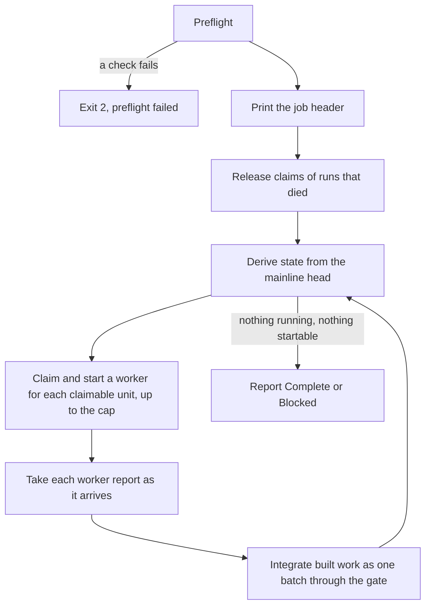

# Runs

> Understand what `vitrify run` does between preflight and its Complete or Blocked report: dispatch, integration, retries, spec changes, interrupts, and where the work happens.

Use this page to learn how the orchestrator behaves, so that what you see during a build makes sense. A **run** is one invocation of `vitrify run`: a deterministic state machine over repository state that drives inference workers through your harness CLI until the SDD is Complete or Blocked. For the steps to start and resume a build, see [Run a Build](../../user-guides/run-a-build.md); for the internals, see [Architecture](../architecture.md#managed-execution-pipeline).

## Why the Orchestrator Exists

A procedure a model follows varies from run to run. vitrify keeps control flow, scheduling, and state transitions in Rust and invokes a model only at the leaves: each worker builds one unit, and an escalation call judges a unit that keeps failing. The orchestrator drives inference; inference never drives the loop. The same state machine is also written down as an interactive procedure, `vitrify brief kickoff`, for building from a harness session.

## What a Run Is

A run builds exactly one SDD and is identified by its job ID.

- **One SDD per run.** `--sdd` names it; without the flag, the repository must hold exactly one. The SDD is resolved once, in preflight, and pinned by its path under the repository root: every later step — claims, worker prompts, the gate, the reports — reads that same path in whichever checkout it is working in, and never searches again.
- **One job ID.** `run-<UTC timestamp>-p<pid>` names everything the run writes: its holders are `<job>-w<i>`, and its logs are in `.vitrify/logs/<job>/`.
- **Namespaced work.** Branches are `sdd/<sdd>/<unit>/c<seq>` and worktrees `<sdd>-<unit>-c<seq>`, carrying the SDD's slug, so nothing of one SDD is touched by a run on another. A name that already exists belongs to someone else: the run refuses it rather than replace it.

## Run Lifecycle

A run keeps every worker slot busy until nothing more can happen. This diagram shows the loop.



1. **Preflight** refuses to start if any check fails.
2. **The job header** prints the plan and parameters, and the `Watch:` line, before anything is dispatched.
3. **Recovery** releases the claims of runs that died.
4. **Dispatch** starts a worker for every claimable unit while a slot is free.
5. **Reports** arrive one line per worker, as each session ends.
6. **Integration** gates what is built as one batch and publishes it.
7. **Re-derivation** reads state from the head again and refills the freed slots.
8. **Termination** prints exactly one report when nothing is running and nothing can start, and keeps it.

## Run Behavior

Each stage follows these rules.

### Preflight

`vitrify run` refuses to start if any of these checks fails. It prints each failure as one `preflight failed: <cause> → <fix>` line and exits 2. Use this table to see what each check requires and the fix its line names.

| Check | Passes when | Fix |
| --- | --- | --- |
| SDD | the SDD resolves: `--sdd` names it, or the repository holds exactly one | none in the repository: `vitrify brief authoring`; several: pass one of the printed `--sdd` values; an `--sdd` outside the repository: pass one inside it |
| Status | the SDD is `status: Active` | finish authoring and set it Active: `vitrify brief authoring` |
| Clean tree | no uncommitted changes under the SDD's root | commit or stash the changes under `<root>` |
| Unique slug | no other SDD in the repository shares its `sdd:` slug | rename one of the `sdd:` slugs |
| Mainline | the primary checkout is not behind mainline, and with `origin`, no local commits are missing from it | bring the checkout up to date as the note before the line says; publish local commits first (`git push origin <branch>`) |
| Lint | `vitrify lint --built` is clean: every check but L7, since built state is expected on resume — including L9, so an SDD whose pin no longer matches its authority is not built until it is synced | one line per finding, each with its remediation (for a stale pin, `vitrify pin sync --sdd <root>`) |
| Audit | the audit is clean; if the only findings are lapsed leases, they are released and published instead | one line per finding, each with its remediation (for an unmarked trace mismatch, write the change entry and run `vitrify change apply --sdd <root>`) |
| §5 Commands | Bootstrap, Build, and Lint are declared, and each exits 0 from the repository root; the Test command is not run here, since whether tests exist or pass before the build is the SDD's [test posture](test-posture.md) | a missing command: add it to the SDD's §5 Commands; a failing one: run it from the repository root and fix what it reports |
| Harness | `~/.vitrify/config.toml` records a working harness: `harness.preferred` if set, else the first of `claude`, `codex`, `opencode` | `vitrify probe` |
| Harness profiles | the role profiles parse: those of `~/.vitrify/config.toml`, with the repository's `.vitrify/config.toml` overriding them key by key | correct the line the error names, in the file it names, then `vitrify probe` |
| Worktree root | the worktree root is usable (see [Worktrees](#worktrees)) | point `run.worktree_dir` at a directory no ignore file of the repository covers |

`vitrify run --dry-run` runs the same preflight, prints the header and the plan, publishes nothing, and ends with the command that starts the run it checked (`Start: vitrify run --sdd specs/calc`). Its header has no `Watch:` line: a dry run records no job to watch.

A single-file SDD forces the worker cap to 1, since every status edit lands in the same file. At preflight an unmarked trace mismatch is still a refusal, so that a spec edit nobody meant does not quietly become a rebuild; staleness is applied mechanically only once a run is under way.

### The Job Header

Before anything is dispatched, the run prints its header: the job ID, the SDD, the plan, and the parameters. Its last line names what to run next:

```text
Watch: vitrify run status --job <job> [--follow] · once it ends, the same command prints the report · procedure: vitrify brief run
```

`<job>` is the run's job ID. The header begins the output, so whoever started the run — a human, or an agent reading the first part of a long result — sees how to watch it and where its report will be. [Monitor a Run](../../user-guides/monitor-a-run.md#read-what-the-run-prints) shows a whole header.

### Recovery

Before dispatching, a run releases every claim held by a run that is gone. A run holds a lock on `.vitrify/jobs/<job>.lock` for as long as it lives. A later run that finds the lock free — the operating system frees it however the process ended — knows that run is dead: it releases its claims (`recovered U-###: … claim released`), commits whatever its workers had written to their branches, and sweeps its scratch. It cannot stop workers it did not start; if any outlived their run, it prints the `kill` command that does. Claims of runs still alive, and of holders it has no local trace of (another machine, another checkout), are left to their leases.

### Dispatch

The run re-derives state from the mainline head and starts a worker for every claimable unit, in unit order, while a slot is free. `depends_on` alone decides; nothing waits for a "wave" to finish. For each unit, the run claims it, adds the worktree `<worktrees>/<sdd>-<unit>-c<seq>` on branch `sdd/<sdd>/<unit>/c<seq>`, and spawns the recorded harness command plus the role's model and effort flags. The worker prompt — generated by `brief build-unit` from that worktree, at its claim commit — is the final argument, and the worker gets a `TMPDIR` that no other worker or gate command is using. A monitor per worker renews its lease when less than `renew_fraction` of it remains, and kills the worker's process group at `worker_timeout_minutes`.

A unit whose reading set does not resolve at its claim commit is not given to a worker. Its claim is released and it is set aside, like a blocked unit, until its reading set changes (`U-002 (c1): not started — …`). This is where a pin whose authority has moved since preflight is caught: the body a worker would be handed is not the body the pin, and so the trace, covers.

### Worker Reports

The last line of each worker's output is its report, and a freed slot is refilled at once.

- `built` — the run commits the worktree and queues the unit for integration, keeping its lease alive until the gate has decided. Workers never run `git commit` themselves.
- `blocked` — the worker's `Q-###` is landed in the Decision Log, and the unit is parked until its reading set changes.
- `released`, missing, or unparseable — the claim is freed, and the attempt counts as failed.

### Integration

One integrator runs one gate at a time, in the integration checkout `<worktrees>/mainline`. It takes every unit that is waiting as one batch and runs the [integration gate](gates.md#the-integration-gate): fencing and write-set checks per unit, a `--no-ff` merge per unit, the input check, then the gate commands once over the merged tree, and one commit stamping every unit of the batch Verified, published by compare-and-swap or push. A red batch is integrated again one unit at a time. A lease that lapses elsewhere, or a trace that a spec change staled elsewhere, while the gate ran is mainline's own state: it is put right and the batch is published, not rejected for it.

### Retries and Escalation

An attempt that does not land — rejected by a gate, released, timed out, or interrupted — is committed to its own branch under a note saying why (`sdd: abandoned attempt U-### (c<seq>) — <outcome>`), and its worktree is removed. The unit's next claim starts from the files it owns on that branch, its worker is told what failed, and it runs under the `retry` role profile.

When the work of one unit has failed `abort_failed_waves` times (default 2) — a red gate, a write-set violation, a missing Built stamp, a timeout, a worker that gave up; not a lost race or a lapsed lease — the run makes one escalation call and enforces its JSON verdict: `retry`, `release`, `block`, or `abort`. The judge is asked once per unit; after twice as many attempts that did not land, whatever the reason, the unit is set aside for the run. A merge conflict escalates at once.

### Spec Changes Mid-Run

State is re-read from the head after every event, and every `run.poll_seconds` (30 by default) when there is none. When the SDD's text has changed there:

- Built and Verified units whose recorded trace no longer matches are marked Stale — one commit, with the cause in a `stale` journal event — and rebuilt;
- a worker still building from the old text is stopped, and its unit started again;
- a parked unit whose reading set changed returns to the pool.

A change to a unit's own entry that lands while its work waits for the gate is caught before the merge: the unit is rebuilt from the new text, and the change never surfaces as a merge conflict in the unit file. A change to *another* SDD's contract moves no trace here: a unit that pins it is set aside at its next dispatch, because the authority's body no longer matches the pin's hash, and the next preflight refuses until the pin is synced. With `--wait`, a run with nothing left but blocked units stays alive for exactly such a change, printing the interim report once per head.

### Interrupts

On SIGINT, SIGTERM, or SIGHUP, the run stops its workers and the gate command in progress, commits each attempt's work to its branch, releases every claim it holds, closes `run.json`, and then ends by the signal. Nothing half-gated is published. A second signal ends it at once, and the next run recovers what is left. A signal the run was started ignoring stays ignored — `nohup vitrify run &` survives its terminal — and a run whose output nobody reads any more (`vitrify run | head`) carries on rather than dying on the closed pipe.

### Termination

When nothing is running and nothing can be started, or escalation says `abort`, the run prints exactly one report:

- **`Complete.`** — every non-Retired unit is Verified at the current SDD version, the audit is clean, the replay is consistent, and the §5 Test command (if the SDD has one) passes at the head. Exit 0.
- **`Blocked.`** — the progress line, any audit findings and a failing Test command, then each unfinished unit's blocker: an open `Q-###`, a failing gate command, its last worker outcome, or the dependency chain holding it. Exit 2.

Both end with the last five journal events, whose replay line reads `replay: exit 0 (consistent)` when the journal agrees with the front matter, and re-running continues from repository state. [Monitor a Run](../../user-guides/monitor-a-run.md#read-what-the-run-prints) shows both report formats in full.

### The Kept Report

The final report — the lines printed from `Complete.` or `Blocked.` on: the status line, the progress line, each blocker, and the journal tail — is also written to `.vitrify/logs/<job>/report.txt` and to the run record as `report`, a list of lines (`null` until the report is printed). Once the run has ended, `vitrify run status` prints it under `Report:`, and `vitrify run status --json` carries it as `report`, after `terminated`. The report of an hours-long run is the last thing it prints, so it can be read on its own, long after the output that carried it is gone.

## Where a Run Works

A run builds and gates outside your working tree and publishes to your mainline. These rules decide where.

### Worktrees

The unit worktrees and the integration checkout live outside the repository's working tree: by default under `~/.vitrify/worktrees/<repo>-<hash>/`, or wherever `run.worktree_dir` points. No ignore file of the repository — not its own `.gitignore`, not the `*` in `.vitrify/` — is above them, which matters: a checker that honours ignore files above its root reads nothing in a directory they cover, and passes. A `run.worktree_dir` inside the working tree is excluded through `.git/info/exclude`, and refused if one of the repository's ignore files covers it. `.vitrify/` itself holds only scratch, and nothing is ever built in it.

### The Primary Checkout

Nothing is built or gated in your own checkout, and a run can be started from it or from any linked worktree (`--sdd` is then a path from there). When it has mainline checked out, it follows every commit the run publishes — the same fast-forward of index and files that `git merge --ff-only` does, so work in progress there rides along. It is never `reset`, and nothing of yours is overwritten: if an uncommitted change or an untracked file is in the way of a published change, the checkout is left exactly as it is, and the run says so once when it happens and again as its last word. Such a checkout is *behind* its own branch — `git status` shows the missing commits as staged reversals — so commit nothing from it until it has caught up. See [The Primary Checkout Is Behind](../../resources/troubleshooting.md#the-primary-checkout-is-behind).

### Sparse Checkouts

git gives a new worktree the sparse-checkout settings of the checkout it is created from, so if the primary checkout is sparse, every worktree vitrify makes is sparse too: files outside the patterns are tracked but absent there, and what gets built and gated is a partial tree. Switch sparse checkout off, or make sure the patterns cover the SDD, its `scope_roots`, and everything its §5 Commands read. Hiding a repository's other SDDs this way is no substitute for `--sdd`.

### Publishing

Whether commits go through `origin` or move the local branch is decided once, in preflight (`Remote:` in the header), and holds for the whole run. If `origin` stops answering, a claim or a release fails and is reported; it is never put on a local branch nobody else sees.

## Inference Roles

A run invokes your harness in three roles, each with its own model and effort from the role profiles in `~/.vitrify/config.toml`, which a repository's `.vitrify/config.toml` may override. Use this table to see when each is used.

| Role | Invoked for |
| --- | --- |
| `worker` | the first attempt at each claimable unit, several in parallel |
| `retry` | a unit's second and later attempts, with the failed attempt's files and the reason it did not land |
| `escalation` | the rare one-shot verdict on a unit that keeps failing, or on a merge that conflicts |

See [Harness CLIs](../../cli/harnesses.md) for the profiles and their defaults.

## Limitations

These are the boundaries of what a run does.

- One run builds one SDD. Build several in dependency order, one run each; vitrify guarantees that such runs cannot damage each other, not an order between them.
- A run cannot stop workers that outlived a run it did not start; it prints the `kill` command instead.
- vitrify does not count tokens or cost. Whatever the harness itself reports about a session is in the last events of that worker's log.
- Claims of holders the run has no local trace of — another machine, another checkout — are left to their leases.
- Nothing in this version assumes more than hundreds of units.

## Practical Guidance

- Run `vitrify run --dry-run` first: it shows the whole preflight and the plan, and publishes nothing.
- Keep the primary checkout on mainline and free of changes in the published paths while a run is going, or expect it to fall behind.
- Fix the spec on mainline while the run is going instead of restarting it, and use `--wait` when only blocked units remain.
- Stop a run with one Ctrl-C and let it clean up; a second signal is for emergencies.
- Keep `run.worktree_dir` outside any directory that your repository's ignore files cover.
- Raise `--cap` for wide bundles; dispatch is continuous, so a large cap is used fully.
