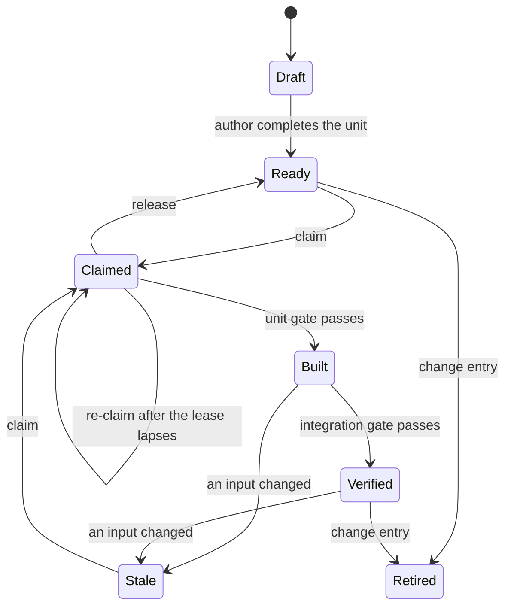

# Work Units

> Understand work units — the buildable pieces of an SDD — and their ownership, dependencies, reading set, and status lifecycle.

Use this page to learn what a unit is and how it moves from Ready to Verified. A **work unit** (`U-###`) is the smallest buildable piece of an SDD: one worker builds one unit in one session, writes only the files the unit owns, and the unit is judged only by its gates. Read [Specs: TDD and SDD](specs.md) first; [Contracts](contracts.md) covers how units share surfaces, and [Build State](build-state.md) covers how claims and traces are recorded.

## Why Units Exist

Splitting work is plan-time authoring, never a decision a model makes at dispatch. The author sizes each unit so that one worker can build it from a bounded reading set in one fresh session, writes down every decision it needs, and gives it an exclusive set of files. That is what lets vitrify run many workers at once without them duplicating work, colliding on files, or making conflicting implicit decisions. [Design Rationale](../design-rationale.md) records the evidence for plan-time splitting.

## What a Unit Contains

A unit has front matter that vitrify reads and a body that its worker reads. This is the front matter of calc's tokenizer unit before it is built:

```yaml
---
unit: U-003
title: Tokenizer
status: Ready
claimed_by: —
claim_expires: —
claim_seq: 0
depends_on: [U-001, U-002]
parallel_group: A
owns:
  - calc/tokenizer.py
consumes: [C-001, C-002]
built: —
verified: —
trace: —
---
```

Use this table to see what each part holds and who writes it.

| Part | Holds | Written by |
| --- | --- | --- |
| `unit`, `title` | the ID (`U-###`) and name | author |
| `status` | the unit's place in its lifecycle (below) | author, then vitrify |
| `depends_on` | units, or pins of this SDD (schema 2.1; each stands for the units that produce it in another SDD), that must be Built or Verified before this one can be claimed | author |
| `parallel_group` | the authored group of mutually independent units, if any | author |
| `owns` | the exclusive write-set globs | author |
| `consumes` | the contract IDs it reads | author |
| `claimed_by`, `claim_expires`, `claim_seq` | the holder, the lease expiry, and the fencing token | vitrify |
| `built`, `verified`, `trace` | the stamps and the input-trace hashes | vitrify |
| Requirements | EARS-form requirements `U-###.R<n>`, typically 2–8 per unit | author |
| Implementation | the decision-complete instructions: exact paths, signatures, algorithm steps, and prohibitions | author |
| Verification | a table mapping every requirement to an exact command | author |

Requirements use EARS sentence forms, such as `WHEN the input contains a run of ASCII digits, THE SYSTEM SHALL emit exactly one NUM token …`. Never edit the fields vitrify writes by hand; use the state verbs.

## Ownership

Every file under the SDD's `scope_roots` that git would commit is owned by exactly one unit, through its `owns` globs, or listed under `unmanaged:` or `tests:` (schema 2.2) in System Layout & Ownership. Lint L2 checks that ownership is exclusive and exhaustive, and a file nobody owns is an orphan (audit check 1). The scans follow git's own ignore rules: an ignored file is never an orphan. A pre-existing test — listed under `tests:`, owned by no unit — is read-only to every unit.

Ownership is also the write rule. A unit's **write-set** is what its `owns` globs match, plus the `status`, `built`, and `trace` fields of its own entry. Before merging, the write-set check rejects any change outside it — another unit's files, `unmanaged` paths, the SDD's own files, or the unit's own spec text — and tests get no exemption. The handoff commits every change git does not ignore, so keep build and test byproducts in `.gitignore`.

## Dependencies and Parallel Groups

`depends_on` forms an acyclic graph (lint L1), ordered foundation-first: a foundation phase blocks everything after it. A **parallel group**, written `[P]` in Execution Order and `parallel_group` in front matter, records the author's plan for units that can run together, and lint L3 holds group members to independence.

The scheduler uses `depends_on` alone. Any two claimable units are independent by construction — neither depends on the other, each has its dependencies built, and ownership is exclusive — so `vitrify run` starts a unit as soon as it is claimable and a worker slot is free, whatever its group. In calc, U-002 builds first; U-003 and U-004 then build side by side; U-005 follows.

### Depending on Another SDD

`depends_on` may name a **pin** of the unit's own SDD (schema 2.1), as well as units. A pin there means: wait until every unit on the `Producer:` line of the pin's authority, in the SDD that owns it, is built. The unit still writes only its own IDs, and the pin stays the one handle between the SDDs.

```yaml
consumes:   [C-001, C-012]   # C-012 is this SDD's pin of core's C-010: the interface
depends_on: [U-001, C-012]   # and wait until the code behind it is built
```

List a pin in `depends_on` when the unit needs the other SDD's **built code**: it imports or links it, installs its package, or runs its CLI in its checks. It must be in `consumes` as well. A pin the unit only reads, as an interface or a data format, stays in `consumes` alone: it orders nothing, so the unit builds while the producer is still building. Two SDDs whose units read each other's contracts as interfaces are normal and need no ordering. A transcription has no authority, and an internal contract is produced by a unit of this SDD, so neither may appear in `depends_on`: name the unit instead. See [Contracts](contracts.md#pins-carry-order-too).

A `schema_version: 2.0` SDD may not list a pin in `depends_on`, and a project run refuses one whose units consume pins; see [Runs](runs.md#what-a-run-is).

### One Graph Across SDDs

A run joins the units of every SDD into one graph. Its nodes are a unit in an SDD, and its edges are the `depends_on` entries, with a pin leading to the units that produce its authority. The graph is ordered by Kahn's algorithm [kahn], and it is validated before anything runs: every entry must resolve, every authority must name producer units, and there must be no cycle.

A cycle through `depends_on` is refused, and **every** cycle is reported, each as the path that closes it, with SDD slugs:

```text
core U-004 → api U-002 → core U-006 → core U-004
```

Kahn's order leaves exactly the units that are on a cycle or wait behind one, and Tarjan's algorithm [tarjan] tells them apart: the units that only wait behind a cycle are named as waiting, not as part of it. Lint L1 checks the entries of one SDD, and L12 checks the authorities and reports the cycles that run through pins.

## Reading Set

A unit's **reading set** is everything its worker reads to build it, in order, and nothing else:

1. `## Ground Rules` of the SDD's core file;
2. `## Technology Decisions` of the core file;
3. the unit's own entry;
4. each consumed contract, in `consumes` order — and, directly after a contract that pins another SDD's, that contract's body.

Keep every unit buildable from its reading set alone. Its size is budgeted: lint L5 fails a unit whose reading set exceeds `lint.readset_budget_bytes` — 65,536 bytes by default, about 16,000 tokens. The budget counts what you wrote; the fields vitrify fills in later are left out, so building a unit never pushes it over. Check one unit with `vitrify readset --unit U-### --budget`.

The reading set is also the staleness set. A unit's trace hashes exactly these inputs, so a change to any of them — and to nothing else — makes the unit Stale. See [Build State](build-state.md#input-traces-and-staleness).

## Unit Lifecycle

A unit moves through seven statuses. This diagram shows the transitions.



Under `vitrify run`, a worker stamps its unit Built in its own worktree. The stamp reaches mainline with the merge, and the integration commit that follows stamps the unit Verified, so both are published together. If the integration gate rejects the work, nothing is published and the claim is released. Use this table to see what each status means.

| Status | Means | Set by |
| --- | --- | --- |
| Draft | still being written | author |
| Ready | complete; claimable once its dependencies are Built or Verified | author |
| Claimed | a holder has a lease on it | `vitrify claim --unit U-### --holder ID`, a mainline commit |
| Built | passed its unit gate; waiting for the integration gate | the worker's `vitrify trace record --unit U-### --stamp built` |
| Verified | passed the integration gate and landed on mainline | the integrator's `vitrify trace record --unit U-### --stamp verified` |
| Stale | an input changed after it was built; it will be rebuilt | `vitrify audit --apply-stale`, a running `vitrify run`, or `vitrify change apply` on a MINOR or MAJOR change entry |
| Retired | removed by a change entry; excluded from progress totals | author |

## Claimable

A unit is **claimable** when every `depends_on` unit is Built or Verified — for a pin, every unit that produces the pin's authority, in the SDD that owns it — and the unit is Ready, Stale, or Claimed with a lapsed lease. A unit that is blocked, set aside, or rotten never counts as built, so only the units that depend on it, in any SDD, wait. The predicate is derived from front matter and never stored. `vitrify locate --units` marks each claimable unit; with `--json` it adds each dependency's status, the holder, the lease expiry, and whether the lease is still live.

## Limitations

These are the boundaries of what vitrify judges about a unit.

- vitrify never reads source code. It judges a unit by the exit codes of the commands its Verification table names and by which paths changed, not by what the code says.
- Lint checks a unit's structure — requirement coverage, budgets, references — but whether its Implementation block is truly decision-complete is the author's judgment.
- vitrify does not choose a model per unit from its size or requirement count. The only signal it uses is mechanical — an attempt failed — and that selects the `retry` role.

## Practical Guidance

- Size each unit at 2–8 requirements, and check it with `vitrify readset --unit U-### --budget` while you write.
- Write the Verification row for each requirement as you write the requirement: every `U-###.R<n>` must appear in a row (lint L6).
- Keep ownership exclusive with narrow globs, and list generated or shared files under `unmanaged:`.
- Put every shared surface in a contract, never in another unit's Implementation block.
- Add a `depends_on` edge only for a real build-order need; every extra edge serializes the build. Across SDDs, list a pin there only when the unit needs the other SDD's built code, never for a surface it only reads.
- Never edit status, stamps, or traces by hand; the state verbs keep them consistent with the journal.
